

  <h1>Rin</h1>
  <h3>by shadow</h3>
  <h3>total time spent : 38 hours </h3>

--- 

### journal #1 research and picking the chip 
time spent : 2 hours   

  
ok so every time i want to talk to a microcontroller over serial i end up borrowing someones usb to uart thing or using the sketchy one from the lab that only works half the time. so i thought why not just make my own, how hard can it be right (it was harder than i thought lol)  
  
first thing was picking the chip. i saw a lot of people use the ch340 or the cp2102 for these, but i ended up going with the mcp2200 from microchip. reasons:
- it does usb 2.0 to uart which is literally the whole point
- it has 8 gpio pins so i can break out extra pins and use them for other stuff later
- it has its own pins for tx and rx leds, so the blinky lights work without me doing anything extra
- the datasheet has a full example circuit which helped a LOT since this is my first usb chip board  

  
| the mcp2200 pinout |
| --- |
| 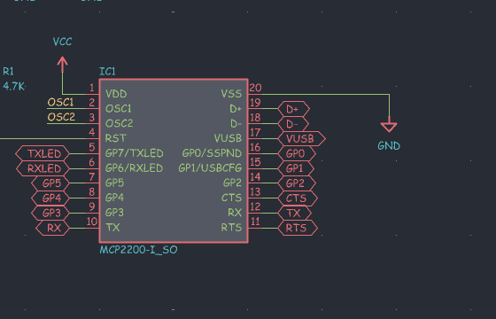 |

i stared at this pinout for way too long trying to figure out what every pin does lol  

spent most of these 2 hours just reading the datasheet. like actually reading it, not skimming. figured out it needs a 12mhz crystal, which caps go where, what goes on the vusb pin and how the usb lines connect. also wrote down what i want on the board:
- some kind of usb port to plug into the laptop
- a way to switch between 3.3v and 5v logic
- tx, rx and power leds
- all the uart pins + gpios on headers so it fits on a breadboard

--- 

### journal #2 starting the schematic!  
time spent : 1.8 hours   

  
opened kicad and started with the main chip. the mcp2200 comes in a soic-20 package which is nice cuz its big enough that i could even hand solder it if i need to  
  
stuff i added around it:
- 12mhz crystal with two 22pF caps going to ground (C3 and C5)
- 4.7k pullup on the reset pin so it doesnt randomly reset
- 2.2uF and 100nF caps on vcc for decoupling
- 330nF cap on the vusb pin, the datasheet says this one is needed or the usb part acts weird  

i used net labels for basically everything instead of drawing wires across the whole page, because last time i did wires everywhere it turned into spaghetti and i couldnt find anything lol
  

  
| mcp2200 schematic |
| --- |
|  |

it looks kinda empty here but everything is connected through the labels i promise

--- 

### journal #3 power and the voltage jumper  
time spent : 1.2 hours   

  
next up was power. usb gives 5v, but a lot of boards like the esp32 run on 3.3v and if you send 5v into their rx pin you can fry them. so i wanted to be able to choose  
  
added an rt9166 which is a 3.3v ldo regulator, it takes the 5v from usb and gives 3.3v. then i made a 3 pin header (P3) with VUSB on one end, +5VUSB on the other and VCC in the middle. put the jumper on one side and the board runs at 3.3v, put it on the other side and it runs at 5v. pretty simple but i was lowkey proud of this one
  

  
| regulator and jumper |
| --- |
|  |

--- 

### journal #4 leds and breakout headers  
time spent : 1 hour   

  
for the headers i went with two 6 pin headers so the board can sit on a breadboard. took a bit to decide what goes where  
- P1 : GP1, RX, GP3, GP4, GP5, GND
- P2 : GP2, RTS, TX, CTS, GP0, GND  

so you get tx, rx, rts and cts for the uart stuff, and all the gpios that are free, plus ground on both sides
  

  
| breakout headers |
| --- |
|  |

then the leds! red on the TXLED pin and green on the RXLED pin so they blink when data is moving (i love blinky lights its the best part of any board), and a blue one for power so you know its plugged in. all three have 470 ohm resistors so they dont blind you

  
| status leds |
| --- |
|  |

--- 

### journal #5 usb input (mini b to usb c)  
time spent : 1.5 hours   

  
at first i drew the usb part with a mini b connector because thats what the symbol i found was. added a ferrite bead and a 4.7uF cap on vbus to filter out noise coming from the laptop  
  

  
| first version, usb mini b |
| --- |
|  |

then i looked at it and was like bro who even has mini b cables anymore. so i switched to usb c, i used the HRO TYPE-C-31-M-12 since its cheap and jlc has it  
  
usb c was more work than i expected tho. you need a 5.1k resistor from CC1 to ground and another from CC2 to ground, if you skip these a c to c cable just wont give the board any power at all. i read about people making that exact mistake and having dead boards so i made sure to add them (R5 and R6). also usb c has two D+ and two D- pins (one set for each side of the plug) so i tied them together so it works whichever way you plug it in
  

  
| usb c input |
| --- |
|  |

--- 

### journal #6 footprints and placing everything  
time spent : 2 hours   

  
schematic done (for now) so i moved to the pcb editor. picked footprints for everything, 0603 for all the resistors, caps and leds since thats small but still doable, soic-20 for the chip, sot-89 for the regulator and a small 3225 crystal  
  
made the board 40 x 30 mm with rounded corners. then the placing:
- usb c on the left edge so the cable comes out the side
- chip right in the middle
- headers along the top and bottom edges, 2.54mm apart so its breadboard friendly
- leds on the right side where you can actually see them  

the crystal and its caps went as close to the chip as i could get them, same with the decoupling caps, because the datasheet says long traces there can cause problems. moved stuff around for ages till the ratsnest stopped looking like a spiderweb
  

  
| footprints placed |
| --- |
|  |

--- 

### journal #7 routing (part 1)  
time spent : 3 hours   

  
the routing took the longest ngl. i started with the usb data lines (D+ and D-) since they should be short and run next to each other, then the crystal, then power, then everything else  
  
around the decoupling caps and the oscillator pins it was super tight, i had to zoom in like crazy to fit the traces between the pads. when a trace wouldnt fit on top i dropped a via and went on the back layer
  

  
| zoomed in near the caps |
| --- |
|  |

this is around halfway. the header side was so annoying because the gpio pins on the chip are in a totally different order than the headers, so the traces kept crossing each other. had to rip up and redo a few of them like 3 times

  
| halfway there |
| --- |
|  |

--- 

### journal #8 cleaning up the schematic  
time spent : 1.2 hours   

  
went back to the schematic because it was getting really messy, random parts everywhere and you couldnt tell what belonged to what. so i put each section in its own box with a title:
- mcp2200 usb-uart
- usb input
- 3.3v regulator + vcc select
- status leds
- breakout headers
- power flags  

way easier to read now, and if anyone wants to look at it later they can actually understand it. also helps me find stuff faster when i need to change something
  

  
| full schematic |
| --- |
| 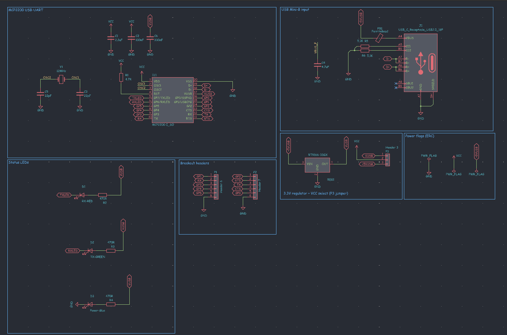 |
|  |

--- 

### journal #9 fixing errors  
time spent : 2 hours   

  
ran erc and got hit with a whole wall of errors. most of them said "input power pin not driven by any output power pins". this is because kicad doesnt know that the power is coming in from the usb connector, so it thinks nothing is powering the chip. the fix is adding PWR_FLAG symbols on the power nets, so i made a little box just for those
  

  
| power flags |
| --- |
|  |

also put no connect flags (the little x) on the usb c pins i dont use, SBU1 and SBU2, so erc stops yelling about those too  
  
then i updated the pcb from the schematic and ran drc. got some clearance errors where traces were too close to pads, and a bunch of silkscreen text sitting right on top of pads. fixed them one by one, rerouted the ones that were too close, moved the text around. kept running drc again and again until it was finally happy, felt so good

--- 

### journal #10 finishing the routing and ground pour  
time spent : 1.8 hours   

  
finished routing everything else after the fixes. then added a ground pour on both the top and the bottom layer, so all the ground pads connect through the copper fill and i didnt have to route ground to every single part by hand. added extra vias around the board to stitch the top and bottom ground together, ended up with 29 vias total  
  

  
| fully routed |
| --- |
| 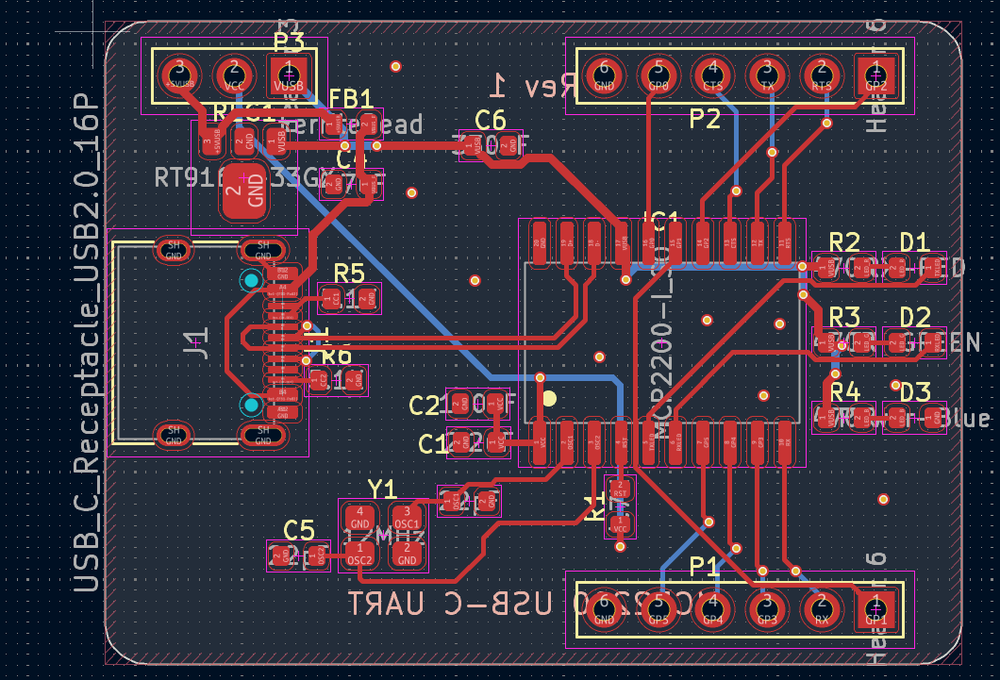 |

| with the ground pour |
| --- |
| 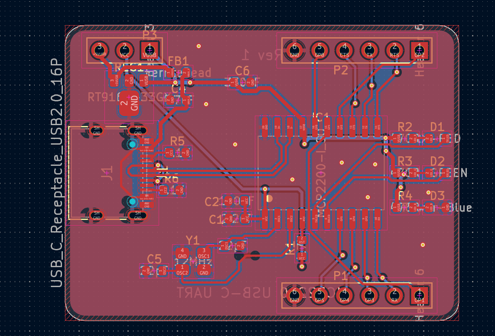 |

it looks so much more like a real board with the pour on :D

--- 

### journal #11 3d view check  
time spent : 0.7 hours   

  
opened the 3d viewer to check if everything actually fits. made sure the usb c is right at the edge so the cable can go in, nothing is overlapping and the headers are lined up. the header models have the pins sticking out of the bottom which looks funny but thats how they'll look after soldering anyway
  

  
| first 3d look |
| --- |
|  |
|  |

it looked clean but kinda boring. needed some art :D

--- 

### journal #12 art time!  
time spent : 2.5 hours   

  
my fav part of making any pcb!! first i had to name it, i went with Rin because it sounds cute and short. made a cursive "Rin" logo for the front and a "made with love" text for the back, then imported both with kicads image converter so they turn into silkscreen
  

  
| rin logo | made with love |
| --- | --- |
|  |  |

the rin logo went right next to the chip, and i added a small hack club flag in the corner. on the back i wrote "made with love by shadow" across the whole thing. also hid all the component values on the silkscreen since they were overlapping everything and kept only the names like R1 and C2, it looks way cleaner now  
  
took a while to get the sizes right so the text doesnt run into any pads or vias, had to scale and move it a bunch of times

  
| front | back |
| --- | --- |
| 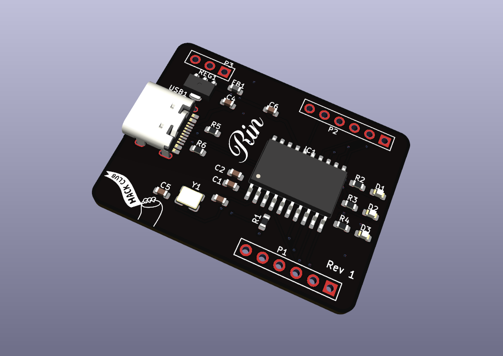 | 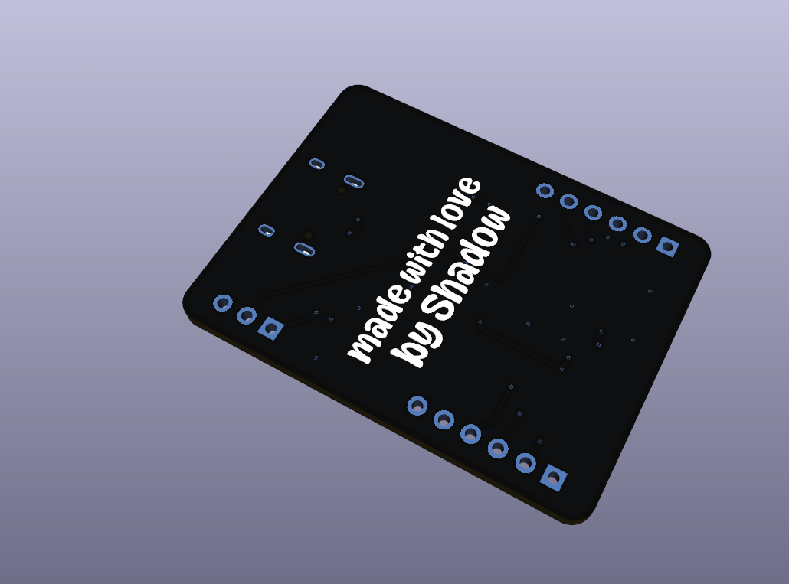 |

--- 

### journal #13 final renders, gerbers and github  
time spent : 1.3 hours   

  
almost done! tried the gold pad look in the 3d viewer and it looks sooo good with the black board, took the final renders with that  
  
then made the gerbers, drill files, bom and the position file for jlcpcb. got a quote for 5 pcbs and assembly for 2 of them, it came to about 34$ with shipping, which is not bad for my own usb to uart board. after that i wrote the readme, sorted all the files into folders and pushed everything to github
  

  
| final front | final back |
| --- | --- |
| 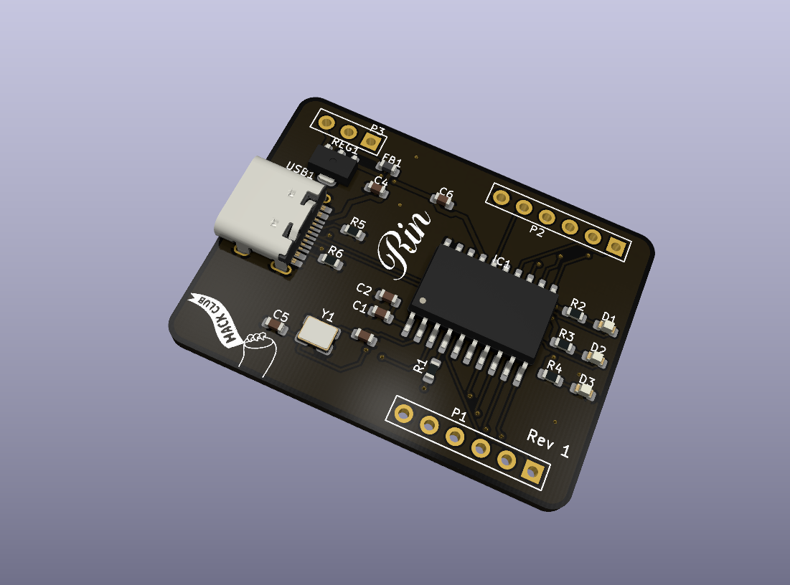 | 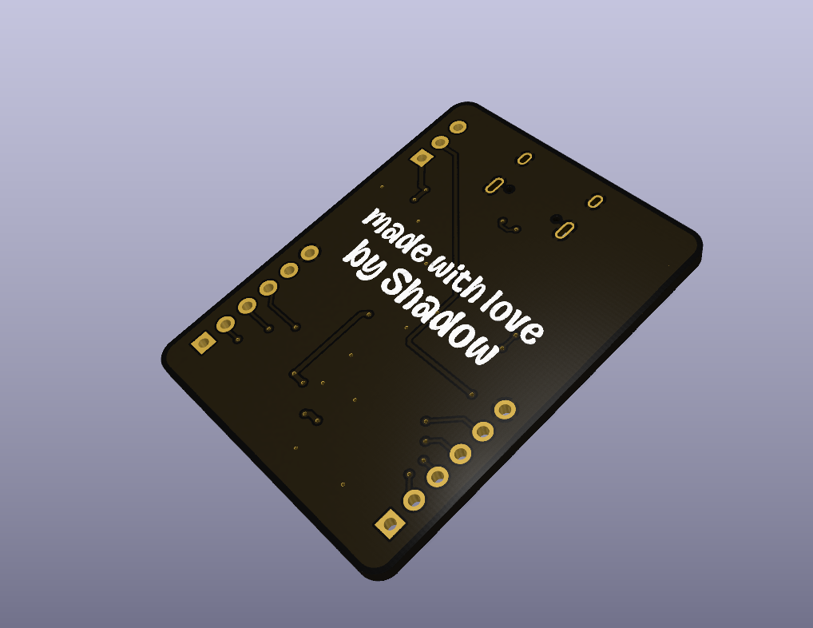 |

--- 

### journal #14 v2 time! picking a new chip  
time spent : 1.5 hours   

  
ok so after finishing rin v1 i kept looking at it and thinking it could be better. its kinda big, the mcp2200 needs a crystal, and the thing i actually use a usb to uart for the most is flashing esp32s. and with most adapters you have to hold the boot button and press reset every single time you upload, which is so annoying  
  
so i decided to make a v2. this time i went with the ch340c, its super common, cheap, and the "c" version has the oscillator built in so i dont need a crystal at all, less parts and less space. read through its datasheet and a bunch of esp32 dev board schematics to see how they do the auto reset thing  
  
plan for v2:
- smaller board
- ch340c instead of mcp2200
- esd protection and a fuse on the usb side
- a proper slide switch for 5v / 3.3v instead of a jumper
- esp32 auto reset so you never have to press the boot button again
  

  
| the ch340c part of the schematic |
| --- |
| 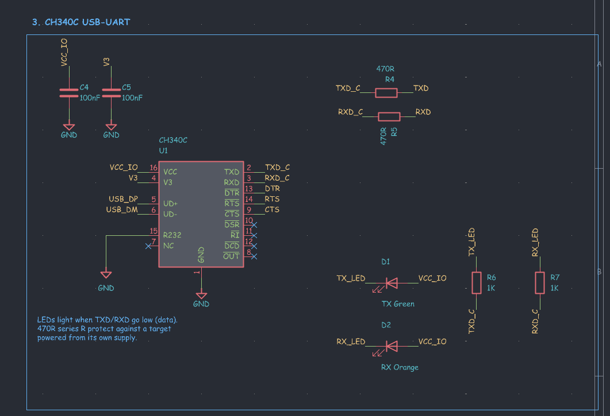 |

--- 

### journal #15 usb c input and protection  
time spent : 1.5 hours   

  
started the v2 schematic with the usb c side again. kept the 5.1k resistors on CC1 and CC2 from v1 (not making that mistake ever lol) and added two new things this time:
- a 500mA polyfuse (F1) on vbus. if whatever i plug into the headers shorts out, the fuse cuts the power so it doesnt hurt my laptops usb port
- a USBLC6-2SC6 on the D+ and D- lines, its a tiny esd protection chip so static from touching the board doesnt kill the ch340c  

v1 didnt have any of this so it was basically raw usb going straight into the chip, v2 is way safer
  

  
| usb c input + protection |
| --- |
| 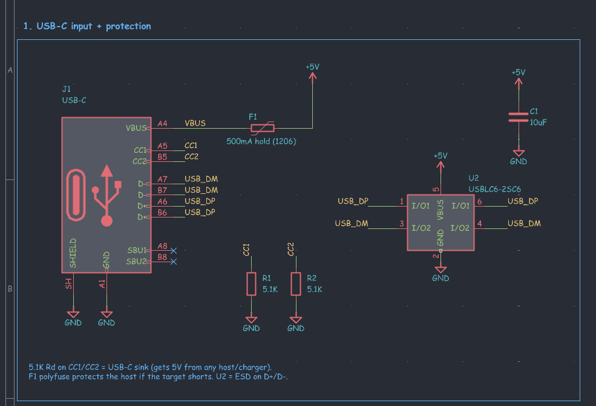 |

| the esd chip |
| --- |
| 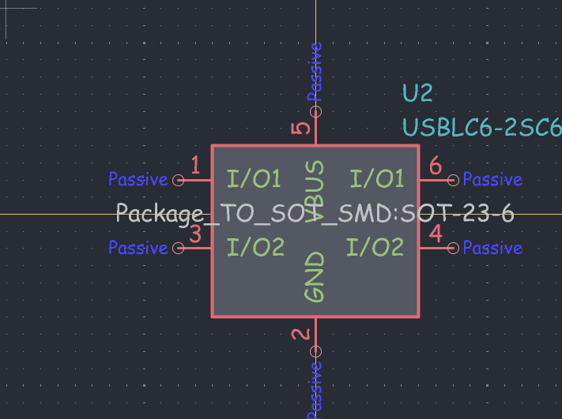 |

--- 

### journal #16 power and the slide switch  
time spent : 1 hour   

  
for the 3.3v regulator i switched to the ap2112k-3.3. its tiny (sot-23-5) and can give 600mA, so its enough to power an esp32 straight from the header  
  
the jumper from v1 worked but its easy to lose the little jumper cap, so this time i used a small slide switch (SW1). slide it to 5V and the io pins run at 5v, slide it to 3V3 and they run at 3.3v. the ch340c has a V3 pin that needs to be tied to vcc when running at 3.3v, so the switch also takes care of that (got that from the datasheet). also added a blue power led with a 1k resistor
  

  
| power and switch |
| --- |
| 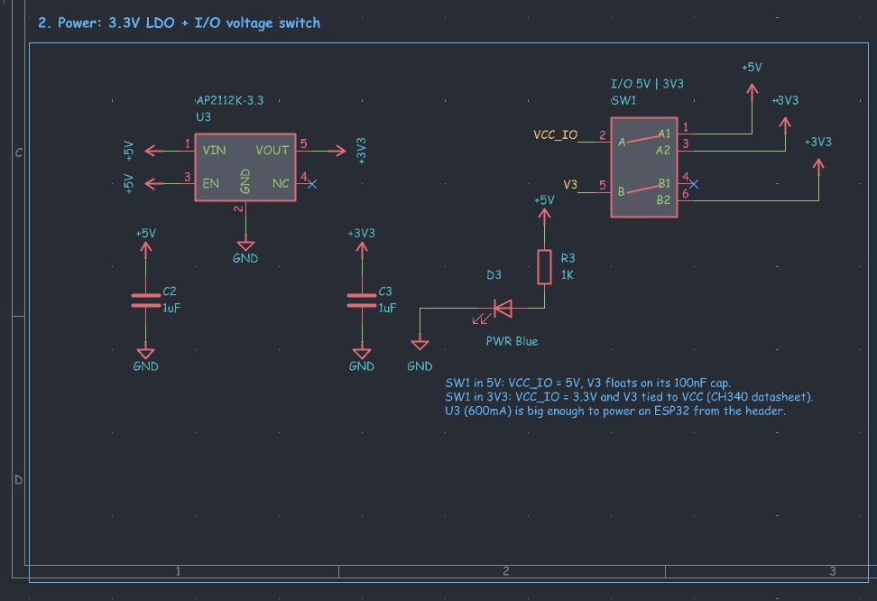 |

--- 

### journal #17 headers and esp32 auto reset  
time spent : 1.5 hours   

  
this was the part i was most excited about. the auto reset circuit is two MMBT3904 transistors (Q1 and Q2) with 10k resistors, connected to DTR and RTS from the ch340c. when you hit upload, esptool toggles DTR and RTS in a certain order which pulls EN and IO0 low at the right time, so the esp32 goes into flashing mode by itself. its the same circuit most esp32 dev boards use so i knew it works  
  
for the headers i went with:
- J2, a 6 pin header with the standard ftdi pinout: GND, CTS, VCC, TX, RX, DTR. so it plugs straight into stuff like an arduino pro mini
- J3, a 3 pin header with EN, IO0 and GND for the esp32  

also put 470 ohm resistors in series on TX and RX so if the other board has its own power it cant push current back into the ch340c
  

  
| headers and auto reset |
| --- |
| 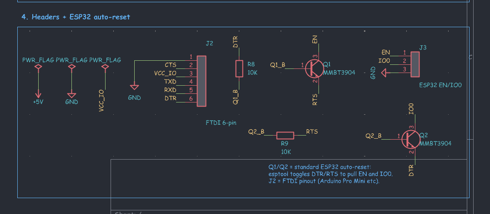 |

--- 

### journal #18 schematic boxes and notes  
time spent : 1 hour   

  
learned from v1 and did the boxes from the start this time. split it into 4 sections, usb c input + protection, power, ch340c and headers + auto reset. also wrote small notes inside each box explaining why stuff is there, like why the 5.1k resistors exist and how the switch works, so future me (or anyone) doesnt have to guess  
  
ran erc, added the PWR_FLAGs right away this time so there were way less errors than v1
  

  
| full v2 schematic |
| --- |
| 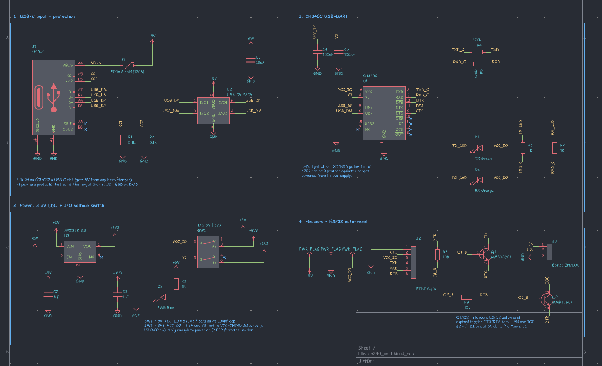 |

--- 

### journal #19 footprints and first try at routing  
time spent : 2 hours   

  
for v2 i went smaller on the parts, 0402 for most of the resistors and caps, soic-16 for the ch340c, sot-23 for the transistors and regulator and the esd chip. the board is 38 x 25 mm now, smaller than v1 even with more stuff on it  
  
i also made a "Power" net class so the vbus and 5v traces are 0.4mm wide while the normal signal traces stay at 0.2mm, since the power lines carry more current. then i placed everything and just started routing to see if it would fit
  

  
| first routing attempt |
| --- |
| 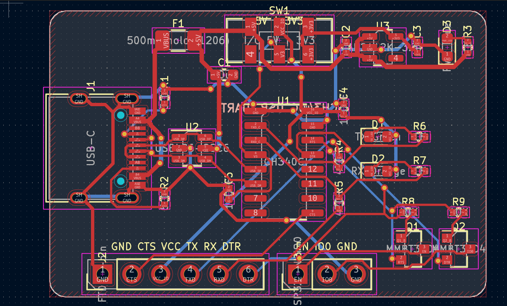 |

it did fit but it was a mess. traces going all over the place and way too many vias

--- 

### journal #20 ripping it up  
time spent : 1 hour   

  
so i deleted all the traces and started again lol. moved the parts around first so things that connect to each other are actually next to each other. the switch and fuse went to the top edge, the esd chip right next to the usb c, the leds and transistors to the right side near the headers. took a while but the ratsnest looked much cleaner after
  

  
| all the traces ripped up |
| --- |
| 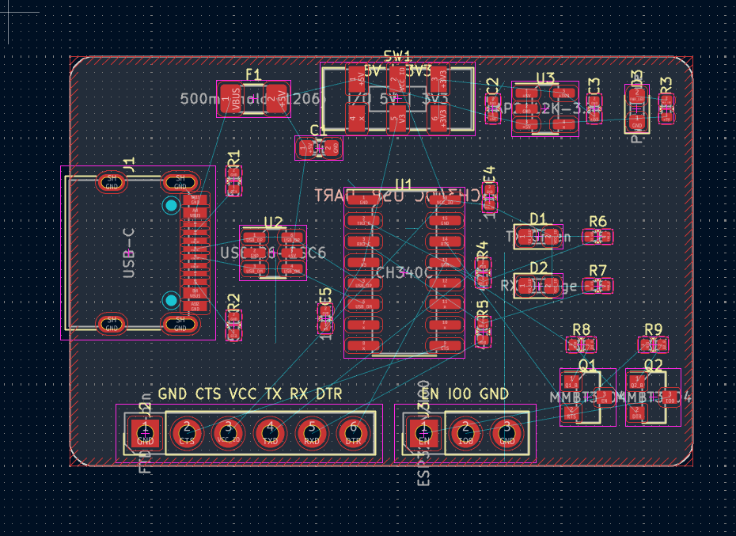 |

--- 

### journal #21 routing again  
time spent : 2.2 hours   

  
round two of routing. went section by section this time and zoomed in a lot  
  
the regulator and the leds first, with the thick 5v traces going around everything
  

  
| regulator | power led |
| --- | --- |
| 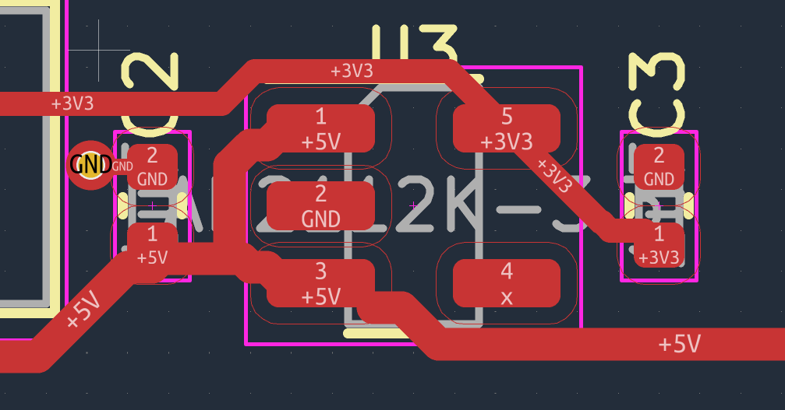 | 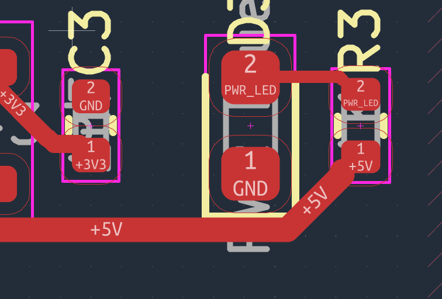 |

the usb c pads are so tiny, vbus had to come out of the A4 pad with the thick trace and squeeze past the other pins

  
| usb c pads |
| --- |
| 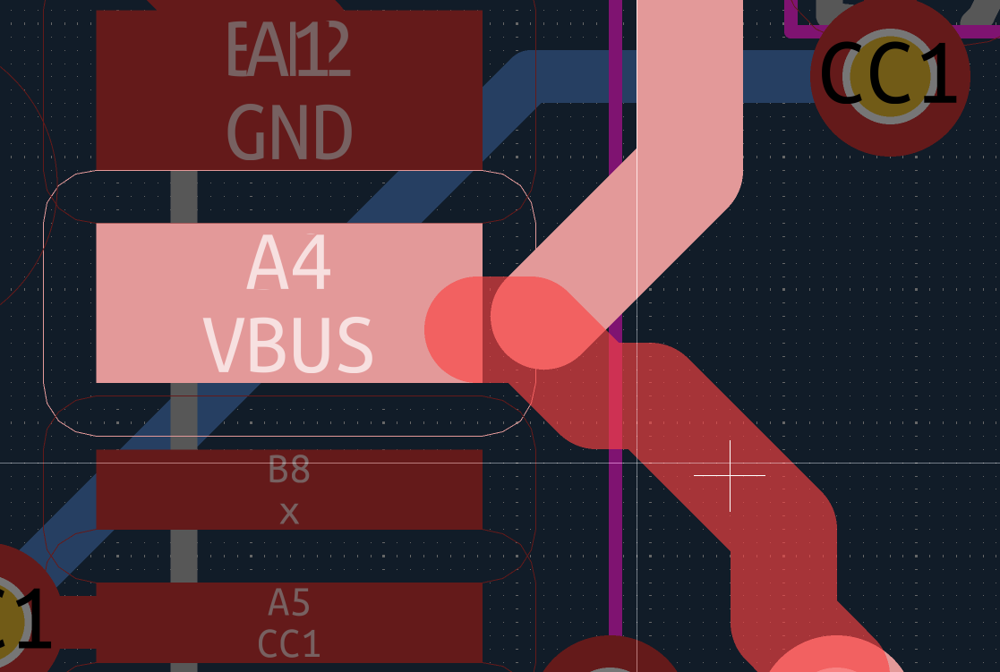 |

then the slide switch and the fuse, which needed a couple of vias to get the 3V3 and V3 lines to the other side

  
| switch and fuse |
| --- |
| 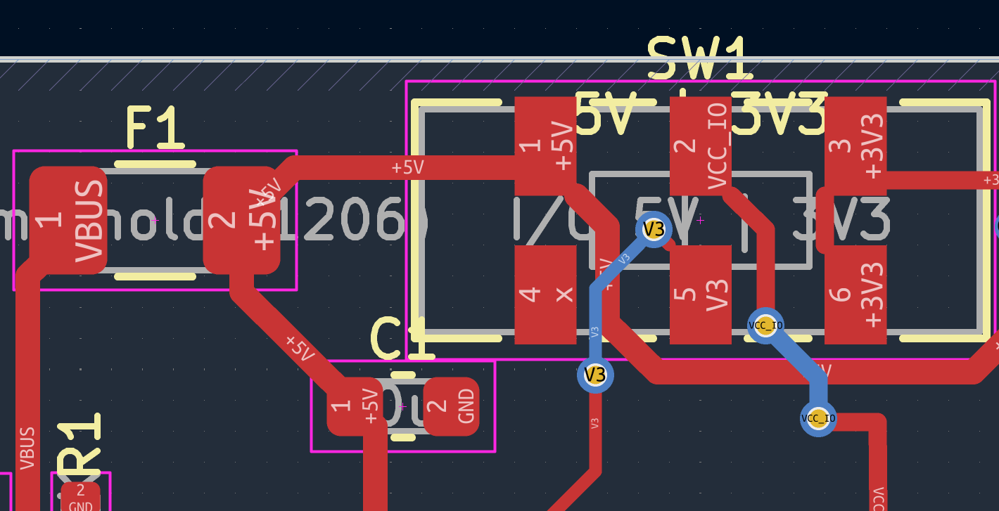 |

and last the auto reset transistors, the DTR and RTS lines cross each other so one of them had to go on the back layer

  
| auto reset transistors |
| --- |
| 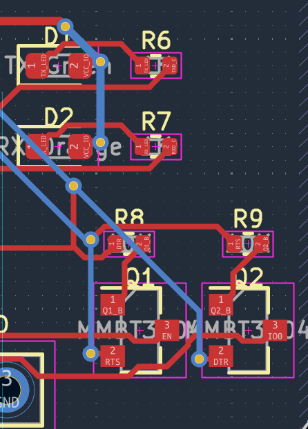 |

--- 

### journal #22 ground pour and stitching vias  
time spent : 1 hour   

  
same as v1, added a ground pour on the top and bottom. then added a bunch of stitching vias all over the board to connect both grounds together properly, ended up with 31 vias total. ran drc and fixed the last few clearance errors
  

  
| routed | with the pour | with stitching vias |
| --- | --- | --- |
| 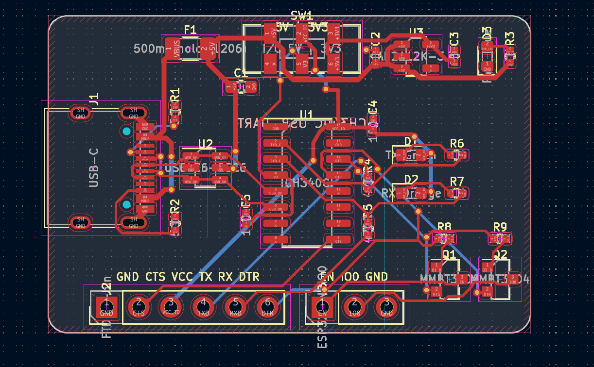 | 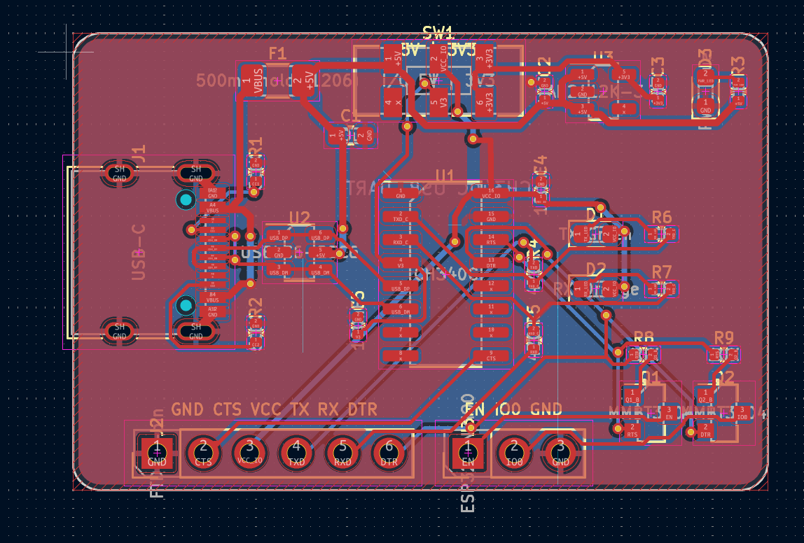 | 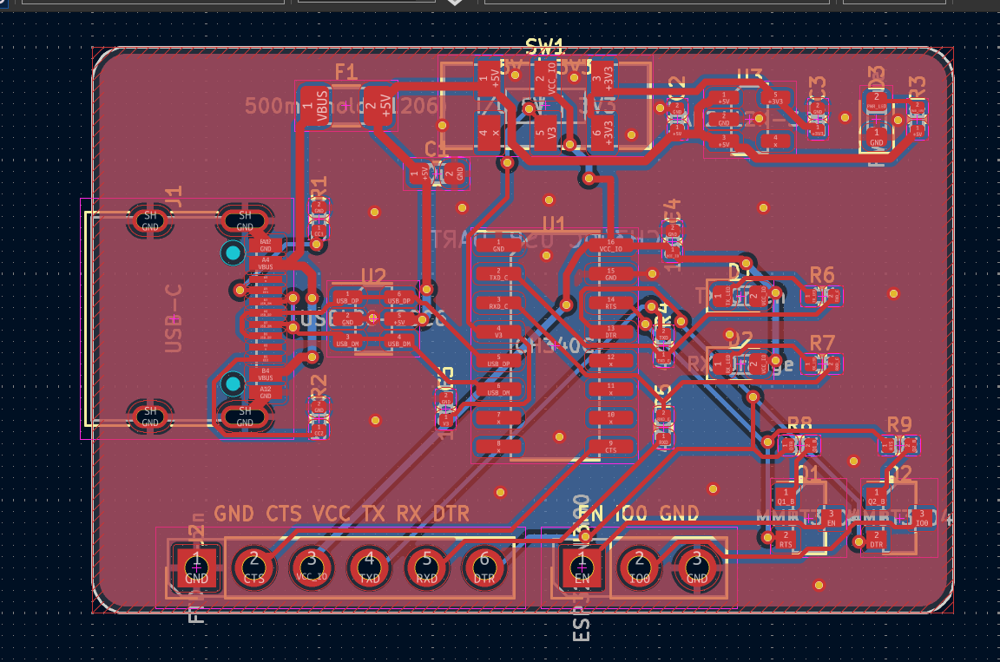 |

--- 

### journal #23 3d check  
time spent : 0.5 hours   

  
checked it in the 3d viewer, usb c is right at the edge, switch is reachable and the headers line up. with the pin headers on it looks like a real usb adapter now  
  

  
| 3d with headers |
| --- |
| 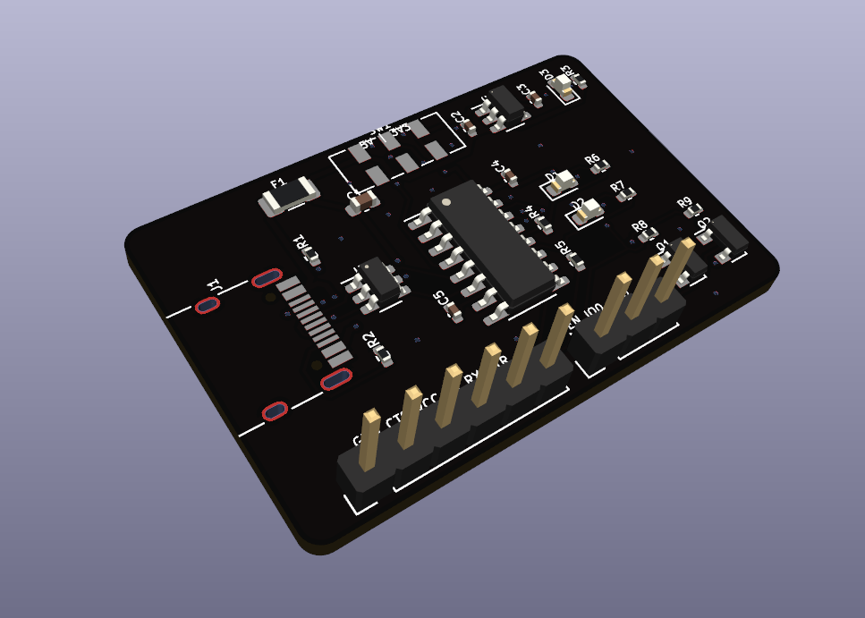 |

--- 

### journal #24 silkscreen labels  
time spent : 1 hour   

  
on v1 you had to check the readme to know which pin is which, which is annoying. so on v2 i wrote the pin names right on the silkscreen next to the headers, GND CTS VCC TX RX DTR and EN IO0 GND. also moved all the reference names so they dont sit on pads and look neat  
  

  
| labels on the board |
| --- |
| 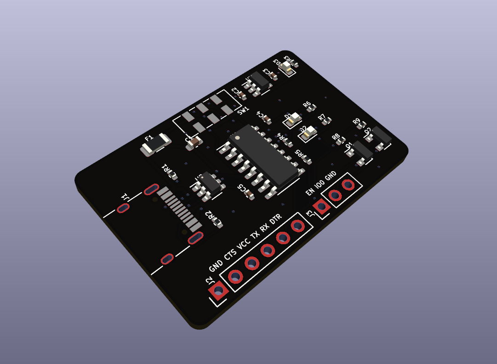 |

| front | back |
| --- | --- |
| 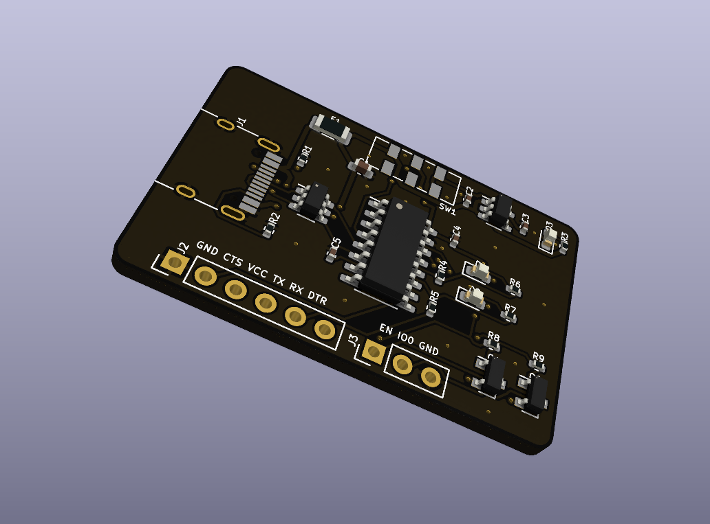 | 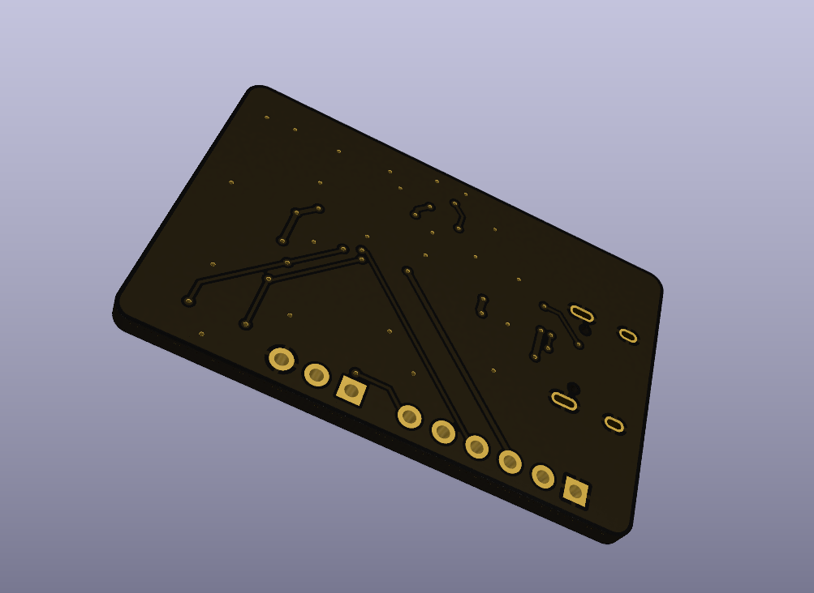 |

--- 

### journal #25 making a poster  
time spent : 1 hour   

  
wanted something nice to show off the project so i made a poster for rin. used the gold render from v1, big RIN text on the side, a short description of what it does and a qr code that goes to the github. took a while to get the layout and the colours right but im really happy with how it came out :D
  

  
| the poster |
| --- |
| 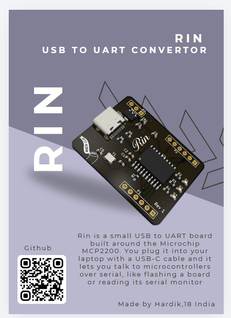 |

--- 

### journal #26 final checks and github  
time spent : 0.8 hours   

  
last round of checks, ran erc and drc one more time, looked over every trace again and compared the board to the schematic. then took the final screenshots, added all the v2 files and pictures to the repo and updated this journal
  

  
| final v2 pcb |
| --- |
| 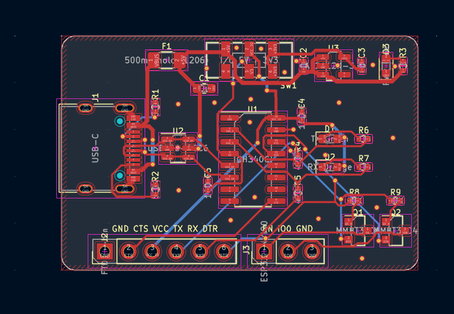 |

thats it for rin v2! if you read till here, thank you :D
