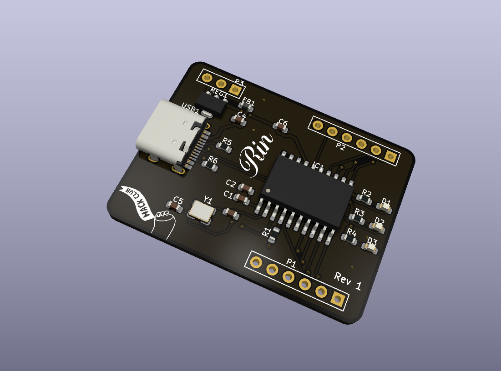
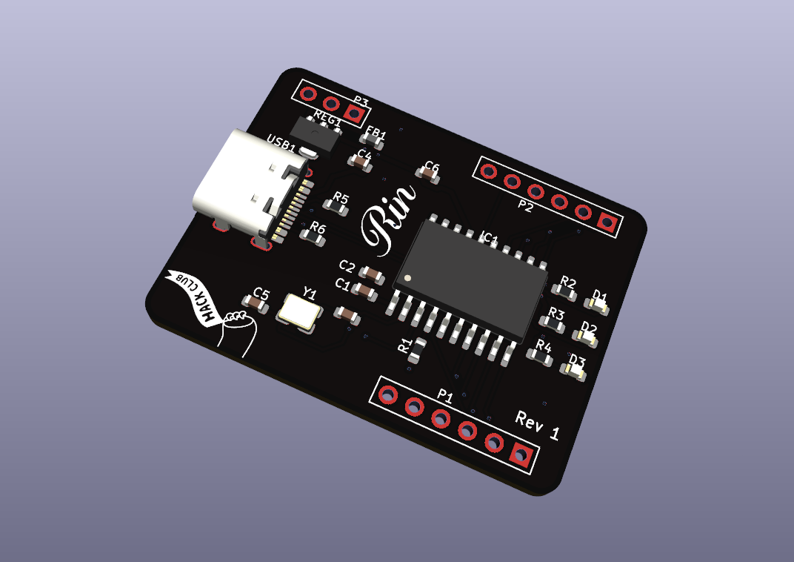
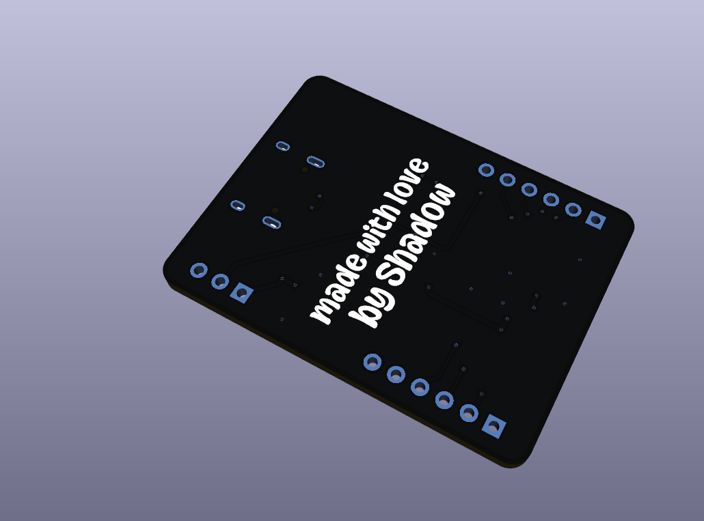
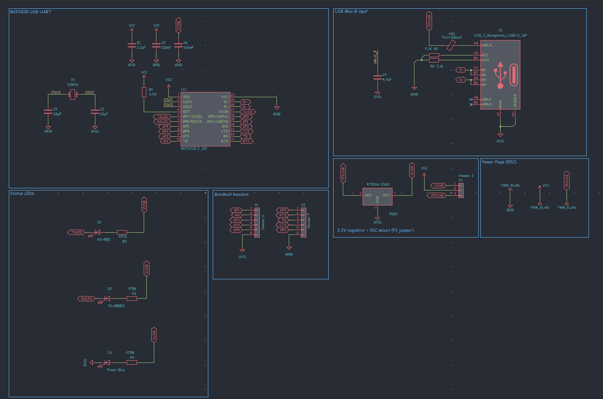
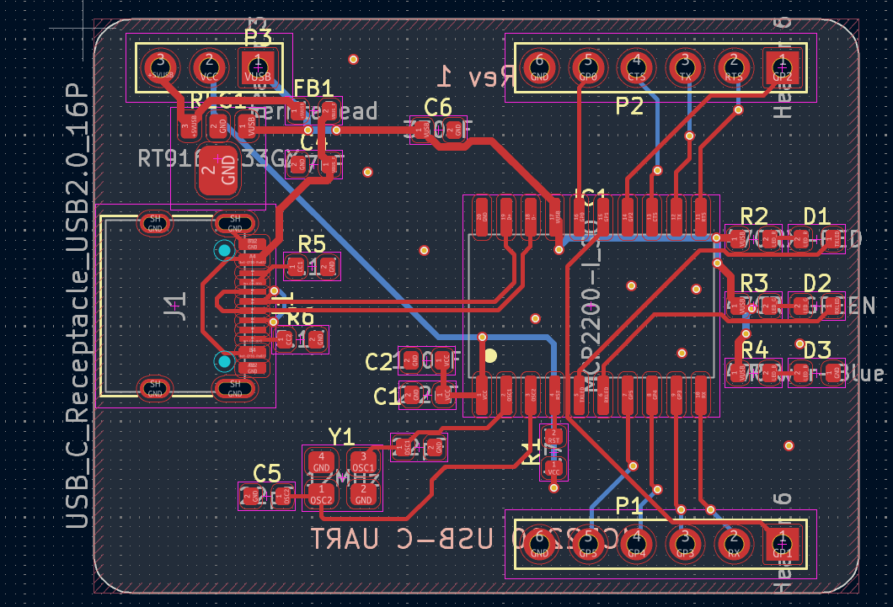
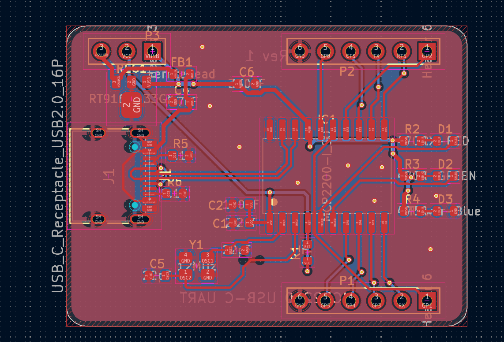
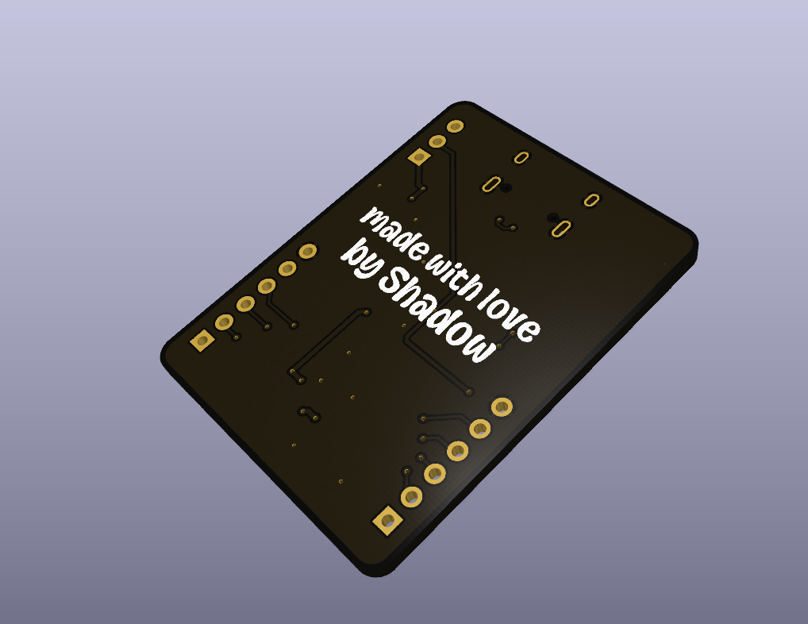

<h1 align="center">
 

 
Rin
 
</h1>

<h3 align="center">

A tiny USB-C to UART converter 

</h3>

  
  

Rin is a small USB to UART board built around the Microchip MCP2200. You plug it into your laptop with a USB-C cable and it lets you talk to microcontrollers over serial, like flashing a board or reading its serial monitor. It also has a jumper to switch between 3.3V and 5V logic, so it works with both 3.3V and 5V boards.

The PCB is 2 layers, 40 x 30 mm, with a black solder mask and art on both sides.

## Features

- USB-C input (with the 5.1k CC resistors so C to C cables work)
- 3.3V / 5V logic select with a jumper
- TX, RX and RTS / CTS broken out
- 6 extra GPIOs from the MCP2200 (GP0 to GP5)
- Red and green LEDs that blink when data goes through, and a blue power LED
- Two 6 pin headers, 2.54 mm spacing so it fits on a breadboard

## Pinout

| P1 | P2 |
| --- | --- |
| GP1 | GP2 |
| RX | RTS |
| GP3 | TX |
| GP4 | CTS |
| GP5 | GP0 |
| GND | GND |

| P3 jumper | Logic level |
| --- | --- |
| VCC to VUSB | 3.3V |
| VCC to +5VUSB | 5V |

Connect TX of Rin to RX of your board, RX to TX, and GND to GND.

## Schematic

| Schematic |
| --- |
|  |

The MCP2200 runs off a 12 MHz crystal, the RT9166 LDO gives the 3.3V, and the USB-C VBUS goes through a ferrite bead before reaching everything else.

## PCB

| Routed | Ground pour |
| --- | --- |
|  |  |

All the passives are 0603, the chip is SOIC-20 and there's a ground pour on both sides stitched together with vias.

| Front | Back |
| --- | --- |
|  |  |

## Why was it made?

Every time I needed a USB to UART converter I had to borrow one or use the old one from the lab that only works half the time. So I made my own, and learned a lot about USB-C and routing tight boards along the way :D

## BOM

| Component | Qty | Price | Vendor |
| --- | --- | --- | --- |
| PCB | 5 (MOQ) | 2$ | JLCPCB |
| PCBA | 2 (MOQ) | 23.16$ | JLCPCB |
| Shipping | | 8.93$ | |
| Total | | 34.09$ | |
