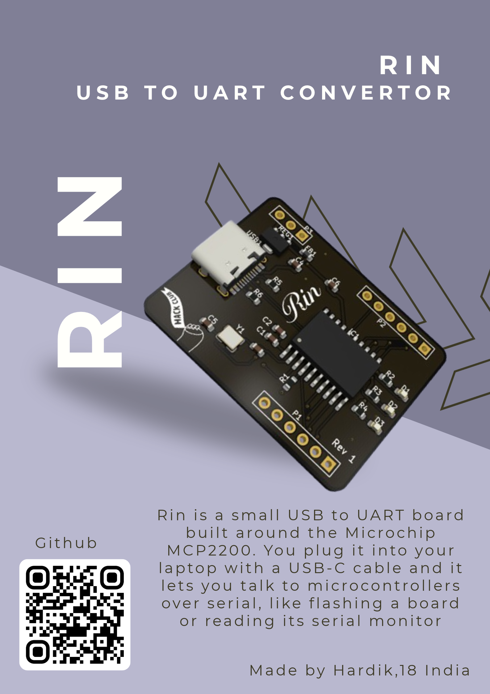
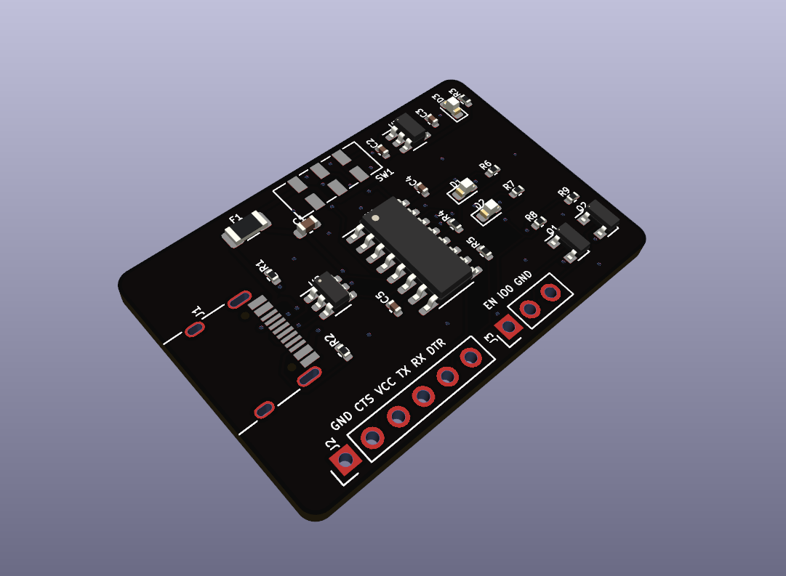
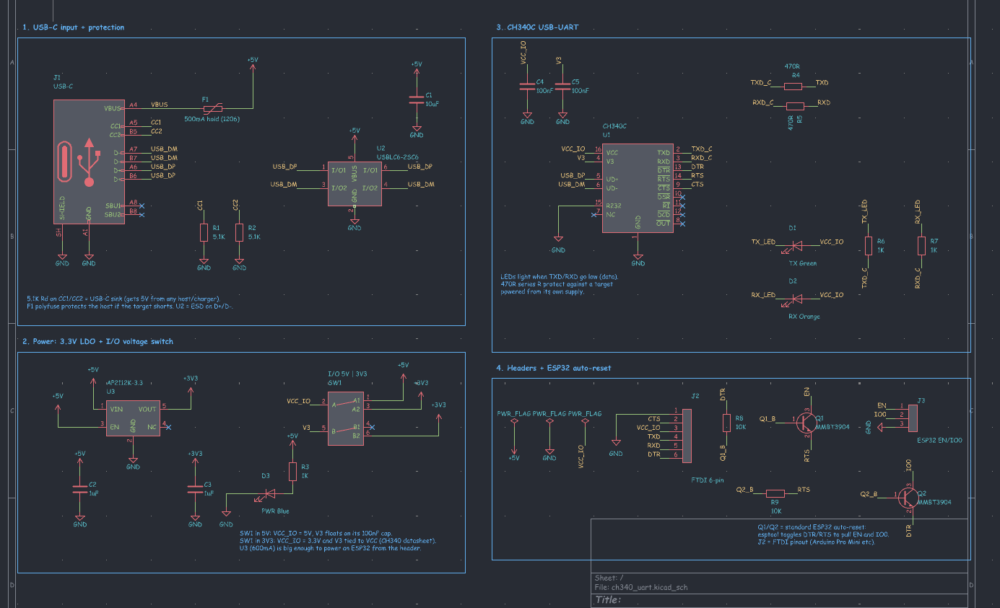
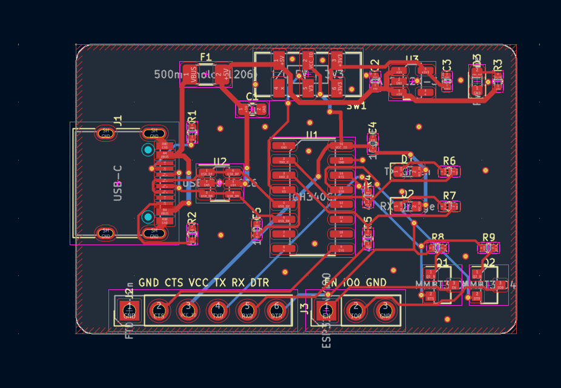
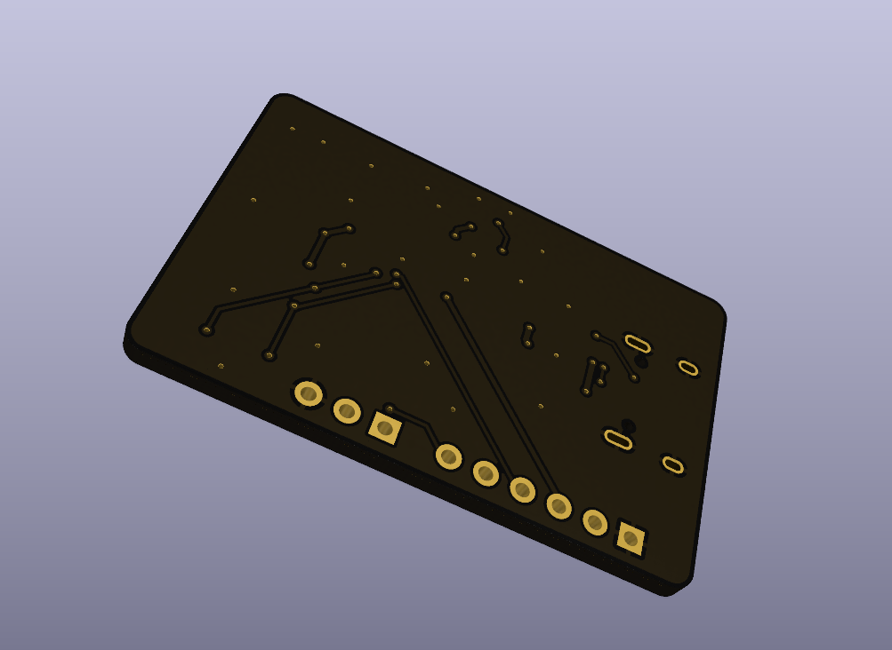

<h1 align="center">
 

 
Rin
 
</h1>

<h3 align="center">

A tiny USB-C to UART converter

</h3>

  

Rin is a small USB to UART board. You plug it into your laptop with a USB-C cable and use it to talk to microcontrollers over serial, so you can flash a board or read its serial monitor. There are two versions of it, v1 uses the Microchip MCP2200 and v2 uses the CH340C and can also flash an ESP32 without you pressing any buttons.

The whole design process is in [JOURNAL.md](JOURNAL.md), around 38 hours for both versions.

## Rin v2 (CH340C)

v2 is the one I would actually use. It's 38 x 25 mm, smaller than v1, and it has some stuff v1 was missing. There's a 500mA polyfuse on VBUS so if the board on the other side shorts, my laptop's USB port is safe, and a USBLC6 ESD chip on D+ and D- so static doesn't kill the CH340C. The CH340C has its own oscillator so there's no crystal anymore.

The 5V / 3.3V jumper from v1 is now a slide switch, cause I kept losing the jumper cap. The AP2112K regulator gives 600mA, which is enough to run an ESP32 straight from the header.

The best part is the ESP32 auto reset. Two MMBT3904 transistors sit on DTR and RTS, and when you hit upload, esptool pulls EN and IO0 low by itself and the ESP32 goes into flashing mode. No more holding the boot button and pressing reset every time!!

The pin names are printed right on the silkscreen so you don't have to keep checking this readme.

J2 is the standard FTDI pinout so it plugs straight into stuff like an Arduino Pro Mini. For an ESP32, connect TX to RX, RX to TX, GND to GND, and EN and IO0 from J3.

| Schematic |
| --- |
|  |

| PCB | Back |
| --- | --- |
|  |  |

## Rin v1 (MCP2200)

  
  

v1 was my first USB chip board. It's 40 x 30 mm with a black solder mask, the Rin logo and a Hack Club flag on the front, and "made with love by shadow" on the back. It runs off a 12MHz crystal, has a jumper to pick 3.3V or 5V logic, red and green LEDs that blink when data goes through and a blue power LED. The MCP2200 also has 6 free GPIOs, so I put them on the headers next to the UART pins.

| Schematic | PCB |
| --- | --- |
|  |  |

## Why was it made?

Every time I wanted to use serial I had to borrow a USB to UART from someone or use the old one from the lab that works half the time. So I made my own! And then I made it again but smaller and with auto reset, cause I flash ESP32s a lot :D

## BOM

v1 cost (JLCPCB)

| Component | Qty | Price | Vendor |
| --- | --- | --- | --- |
| PCB | 5 (MOQ) | 2$ | JLCPCB |
| PCBA | 2 (MOQ) | 23.16$ | JLCPCB |
| Shipping | | 8.93$ | |
| Total | | 34.09$ | |
